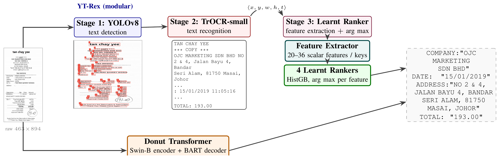

# YT-Rex

**YOLO-TrOCR Ranker EXtractor**: code and run artefacts for the paper

> M. Adıyaman and M. Keskinoz, "YT-Rex: A Modular Receipt Information Extraction
> Workflow with a Small Learnt Ranker on Spatial Features," *Innovations in
> Intelligent Systems and Applications Conference (ASYU)*, IEEE, 2026.

YT-Rex reads four fields (`company`, `date`, `address`, `total`) from a receipt
image in three stages that can each be inspected: a YOLOv8 text detector, a
TrOCR-small recogniser, and four small gradient-boosted rankers. Each ranker
serves one field and picks the answer from a list of candidates, using 20 to 36
spatial and lexical features per candidate.



*Figure 1 of the paper: YT-Rex (top) and the end-to-end Donut baseline (bottom)
on SROIE receipt `X00016469670`.*

## Results

SROIE test set, 347 receipts, single Tesla T4. Cells are token-level F1 / exact
match, in percent.

| Method | Company | Date | Address | Total | Average | Latency | Params |
|---|---|---|---|---|---|---|---|
| **YT-Rex** | 89.09 / 61.38 | 92.12 / 91.93 | 83.96 / 25.07 | 84.15 / 84.15 | **87.33 / 65.63** | 0.67 s/img | 87.45 M |
| Donut (SROIE fine-tune) | 81.49 / 66.57 | 74.64 / 72.62 | 69.37 / 40.63 | 65.71 / 65.71 | 72.80 / 61.38 | 0.418 s/img | 260.77 M |

YT-Rex has the higher F1 on every field. Donut keeps the higher exact match on
`company` and `address`, and is 1.61 times faster per image.

Of the 674 ms YT-Rex spends per image, recognition takes about 544 ms, detection
97 ms, and line merging plus crop preprocessing 34 ms. The four rankers together
take about 1.5 ms.

Because every stage leaves an intermediate output, each remaining error can be
traced to the stage that caused it (Table IV of the paper):

| Field | Detection miss | Recognition error | Wrong selection | Errors | Correct |
|---|---|---|---|---|---|
| Company | 0 | **59** | 29 | 88 | 259 |
| Date | **17** | 10 | 1 | 28 | 319 |
| Address | 1 | **57** | 20 | 78 | 269 |
| Total | 5 | 4 | **46** | 55 | 292 |

## Repository layout

```
01_data_preparation.py    detection, line merging, recognition, candidates and features
02_model_training.py      the four rankers: 5-fold CV, refit on full train, test metrics
03_error_taxonomy.py      assigns each remaining error to a pipeline stage
kaggle_run.py             pushes the three scripts to a Kaggle GPU kernel, fetches the log
baselines/                regex-only field selector, the predecessor of the rankers
ablations/                Stage 3 ablations on the cached OCR output (CPU, seconds)
artifacts/                intermediate outputs of the paper run: OCR lines, candidates, predictions
results/                  result tables and the full log of the paper run
assets/                   figures used in this README
```

The scripts are numbered in run order, which is not the paper's stage numbering:

| Script | Paper | Produces |
|---|---|---|
| `01_data_preparation.py` | Stage 1, Stage 2, and the candidate and feature half of Stage 3 (Sec. III) | OCR line caches, candidate tables |
| `02_model_training.py` | The rankers of Stage 3 (Sec. III-C); Sec. IV-B to IV-D | Table II, Fig. 4, Fig. 6 |
| `03_error_taxonomy.py` | Sec. IV-F | Table IV |

The banners in the logs count scripts, so `STAGE 2` in `results/kernel_log.txt`
is the ranker training, which the paper calls Stage 3.

## How it works

### Detection and recognition (`01_data_preparation.py`)

1. **Detection.** A YOLOv8m model fine-tuned on SROIE with a single class,
   `text`, returns word and phrase boxes. If it finds fewer than three boxes the
   image is cut into 50-pixel horizontal strips instead.
2. **Line merging.** Boxes that overlap vertically by at least half the height
   of the shorter one, and are separated horizontally by at most 4% of the image
   width, are merged. A string such as `TOTAL 150.00` then reaches the
   recogniser as one crop.
3. **Recognition.** Each crop is converted to grayscale, contrast-stretched,
   sharpened, padded and scaled to a height of at least 64 pixels, then read by
   `microsoft/trocr-small-printed` with its pretrained weights. Decoding is
   greedy, in fp16, at most 32 new tokens, in batches of 128 crops sorted by
   width.

The output is a list of lines per image. Each line carries its text, its box,
and the box geometry normalised by the image size.

### Candidates and features (`01_data_preparation.py`)

Each field has its own candidate generator and feature vector.

| Field | Candidates | Features | Positive label in training |
|---|---|---|---|
| `total` | every price match in any line | 36 | value within 0.01 of the ground truth; several candidates can be positive |
| `company` | each of the first 15 lines, plus merges of two adjacent lines | 20 | the candidate with the best token F1 against the ground truth, if at least 0.70 |
| `date` | every match of four date patterns | 22 | exact match after normalisation, otherwise best token F1 if at least 0.50 |
| `address` | blocks of 1 to 7 consecutive lines starting in the first 30 lines, cut at stop keywords | 31 | the candidate with the best token F1, if at least 0.55 |

The features cover box geometry, position on the page, distance in lines to the
nearest keyword above and below, and field-specific signals such as the rank of
a price among all prices on the receipt or whether an address block ends at a
postcode. Figure 2 of the paper groups the 36 `total` features, and Figure 3
lists the features of the other three fields under the names the code uses.
`FEATURES` in `02_model_training.py` is the authoritative list.

### Rankers (`02_model_training.py`)

Each field gets a scikit-learn `HistGradientBoostingClassifier` trained to tell
positive candidates from negative ones: depth 4, up to 400 iterations, learning
rate 0.05, L2 regularisation 2.0, at least 30 samples per leaf, balanced class
weights, and early stopping on a 15% validation fraction. At inference the
candidate with the highest predicted probability in each image is the answer.

The script runs 5-fold cross-validation grouped by image, refits on the full
training split, prints permutation importances, and scores the test split.

### Metrics

Predictions and ground truth are normalised the same way before scoring:
lowercased, a leading `RM` removed, commas turned into full stops, other
punctuation dropped, whitespace collapsed. The paper reports token-level F1 and
exact match. The scripts also compute ANLS with a threshold of 0.5, which is
logged and stored per image but does not appear in the paper.

## Reproducing

### Requirements

```bash
pip install -r requirements.txt
```

`torch`, `ultralytics` and `transformers` are only needed for
`01_data_preparation.py`. Everything else runs on a CPU with `numpy`, `pandas`,
`pyarrow` and `scikit-learn`.

### Data and weights

- **SROIE.** The paper uses the Kaggle copy
  [`urbikn/sroie-datasetv2`](https://www.kaggle.com/datasets/urbikn/sroie-datasetv2).
  The scripts expect `<root>/train/{img,entities}` and
  `<root>/test/{img,entities}`: 626 training and 347 test receipts.
- **Detector weights.** The fine-tuned YOLOv8m checkpoint is not stored in this
  repository. The paper trains it on the SROIE text boxes as a single-class
  detector at image size 1024 with batch size 8 and early stopping (Sec. III-A,
  Table I).
- **Recogniser.** `microsoft/trocr-small-printed` is downloaded from the Hugging
  Face Hub on first use.

### Without a GPU: start from the shipped artefacts

`artifacts/` holds the OCR output, the candidate tables and the per-image
predictions of the paper run, so everything after recognition can be re-run in
seconds.

The ablations need nothing else:

```bash
python ablations/04_ranker_ablation.py
python ablations/05_heuristic_strong.py
python ablations/06_feature_argmax_ablation.py
```

To retrain the rankers and redo the error analysis you also need the SROIE
ground-truth files. Work on a copy, because `02_model_training.py` writes its
predictions into the work directory:

```bash
cp -r artifacts work
export YTREX_WORK_DIR=work
export YTREX_DATA_ROOT=/path/to/SROIE2019
python 02_model_training.py
python 03_error_taxonomy.py
```

### Full pipeline

On a machine with a GPU:

```bash
export YTREX_YOLO_PATH=/path/to/best.pt
export YTREX_DATA_ROOT=/path/to/SROIE2019
export YTREX_WORK_DIR=work
python 01_data_preparation.py
python 02_model_training.py
python 03_error_taxonomy.py
```

Without those variables the scripts fall back to the Kaggle mount points of the
paper run. To run there instead:

```bash
pip install kaggle
export KAGGLE_API_TOKEN=KGAT_...     # Kaggle > Settings > API
python kaggle_run.py all             # push, wait, write kernel_log.txt
```

Set `USER`, `SLUG` and `MODELS` at the top of `kaggle_run.py` to your own
account, kernel and uploaded detector weights first, and change the default of
`YTREX_YOLO_PATH` in `01_data_preparation.py` to the path where Kaggle mounts
those weights. The helper wraps the three
scripts into one notebook cell and runs it with a GPU and internet access.
Kaggle publishes the log only when the session has finished. In the paper run,
detection and recognition took 457 s for the training split and 254 s for the
test split.

### What to expect

- `03_error_taxonomy.py` and the three ablation scripts are deterministic. Run
  on the shipped artefacts they reproduce `results/error_taxonomy.csv` and the
  ablation tables exactly.
- Retraining the rankers gives slightly different numbers on a different
  scikit-learn version. With scikit-learn 1.9.1 the retrained rankers reach
  87.36 F1 / 65.56 exact match on the test split, against 87.33 / 65.63 in the
  paper, and 16 of the 1,388 field predictions change.
- Cross-validation figures move more than the test figures. For `total` the
  validation F1 is 88.82 ± 2.47 with scikit-learn 1.9.1, against 87.85 ± 6.48 in
  the paper run.
- `artifacts/ytrex_predictions.csv` holds the exact predictions behind the
  paper's tables, and `results/kernel_log.txt` is the complete log of that run.
- The timing file of the paper run is not shipped, so `02_model_training.py`
  prints `nan` for latency when started from `artifacts/`. The measured
  latencies are in the log.

## Supplementary results

These were measured after the paper was accepted and do not appear in it.

### What does learning add in Stage 3?

All rows use the same detection and recognition output, read from
`artifacts/spatial_cache_test.pkl`. Only the way a field is selected changes.
Cells are F1 on the 347 test receipts.

| Stage 3 selector | Company | Date | Address | Total | Average |
|---|---|---|---|---|---|
| Regex v1 (`baselines/`) | 75.86 | 91.55 | 77.12 | 39.77 | 71.07 |
| Hand-tuned heuristics v2 | 57.21 | 91.55 | 71.33 | 57.93 | 69.50 |
| Argmax of one feature, chosen on train | 86.37 | 96.57 | 69.52 | 69.74 | 80.55 |
| Learnt rankers | 89.09 | 92.12 | 83.96 | 84.15 | 87.33 |

The third row is the strictest comparison: it sees the same candidates and the
same features as the rankers and differs only in how the features are combined.
Against it, learning adds 6.78 F1 on average, most of it on `address` and
`total`. On `date` a single feature, the distance to the nearest date keyword
above, scores higher than the learnt ranker. See `ablations/README.md`.

### Recogniser comparison on the full test set

Table III of the paper compares recognisers on an 80-image subset.
`results/ocr_sensitivity_347.csv` holds a later run on all 347 test receipts.
The script for that run is not in this repository, and PaddleOCR failed in it
with an API error, which the JSON file records.

| Recogniser | Company | Date | Address | Total | Average F1 |
|---|---|---|---|---|---|
| TrOCR-small | 89.09 | 92.12 | 83.96 | 84.15 | 87.33 |
| Tesseract | 72.66 | 70.51 | 71.55 | 55.33 | 67.51 |
| EasyOCR | 65.25 | 70.41 | 56.35 | 63.40 | 63.85 |

## Not in this repository

- The fine-tuned YOLOv8m weights and the script that trained them.
- The Donut evaluation script. The Donut row was measured with the public
  `philschmid/donut-base-sroie` checkpoint.
- The scripts behind the recogniser comparisons (Table III and the 347-image
  run above).
- The SROIE images and ground-truth files.

## Citation

```bibtex
@inproceedings{adiyaman2026ytrex,
  author    = {Ad{\i}yaman, Muhammed and Keskinoz, Mehmet},
  title     = {{YT-Rex}: A Modular Receipt Information Extraction Workflow
               with a Small Learnt Ranker on Spatial Features},
  booktitle = {Innovations in Intelligent Systems and Applications Conference (ASYU)},
  publisher = {IEEE},
  year      = {2026}
}
```

## Acknowledgements

This work builds on the [ICDAR 2019 SROIE](https://rrc.cvc.uab.es/?ch=13)
dataset, [Ultralytics YOLOv8](https://github.com/ultralytics/ultralytics),
[TrOCR](https://huggingface.co/microsoft/trocr-small-printed),
[Donut](https://github.com/clovaai/donut) and
[scikit-learn](https://scikit-learn.org). The files in `artifacts/` contain text
recognised from SROIE receipts and are subject to that dataset's terms.
